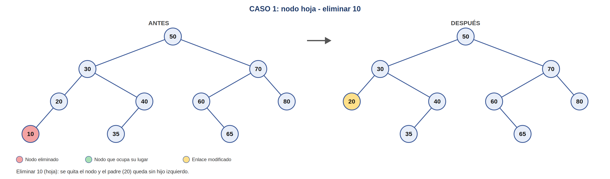
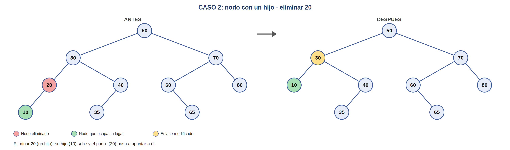
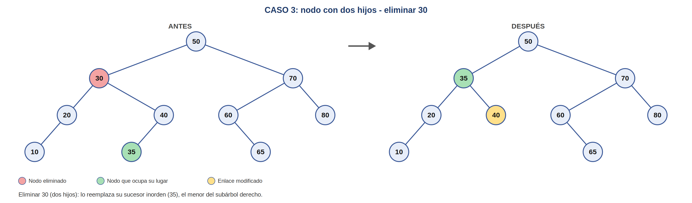

# Actividad 6 – Eliminación en un BST

Continuación del BST anterior (carpeta `06-recorridos`, recorridos en árboles binarios). Se implementa `eliminar(int clave)`
con los tres casos clásicos de eliminación.

## Archivos

| Archivo | Descripción |
|---|---|
| `NodoArbol.java` | Nodo del árbol (se agregó `setDato`) |
| `ArbolBST.java` | BST con recorridos, `buscar`, `eliminar`, `copiar` y `dibujar` |
| `Main.java` | Ejecuta los tres casos, imprime el árbol antes/después y corre las pruebas |
| `diagramas/` | Diagramas en PNG de cada caso |

## Cómo ejecutar

```bash
javac *.java
java Main
```

Al ejecutar se imprime el árbol antes y después de cada eliminación y se regeneran
los diagramas en `diagramas/` (los PNG se exportaron).

## Árbol de prueba

Se insertan los códigos `50, 30, 70, 20, 40, 60, 80, 10, 35, 65`. Cada caso parte de
un árbol nuevo, así los diagramas son independientes.

## Los tres casos

**Caso 1 – Nodo hoja.** No tiene hijos: se quita y el padre queda con ese enlace en `null`.

**Caso 2 – Un hijo.** El hijo ocupa el lugar del nodo eliminado (el padre apunta directamente al hijo).

**Caso 3 – Dos hijos.** No se puede quitar el nodo sin romper el árbol. Se busca su
**sucesor inorden** (el menor del subárbol derecho), se copia su valor en el nodo y luego se
elimina el sucesor, que como máximo tiene un hijo (cae en el caso 1 o 2).
También sería válido usar el predecesor (el mayor del subárbol izquierdo).

```java
private NodoArbol<Integer> eliminar(NodoArbol<Integer> n, int clave) {
    if (n == null) return null;
    if (clave < n.getDato())      n.setIzquierdo(eliminar(n.getIzquierdo(), clave));
    else if (clave > n.getDato()) n.setDerecho(eliminar(n.getDerecho(), clave));
    else {
        if (n.getIzquierdo() == null && n.getDerecho() == null) return null;   // caso 1
        if (n.getIzquierdo() == null) return n.getDerecho();                   // caso 2
        if (n.getDerecho() == null)   return n.getIzquierdo();                 // caso 2
        NodoArbol<Integer> sucesor = minimo(n.getDerecho());                   // caso 3
        n.setDato(sucesor.getDato());
        n.setDerecho(eliminar(n.getDerecho(), sucesor.getDato()));
    }
    return n;
}
```

## Diagramas antes / después

Colores: rojo = nodo eliminado, verde = nodo que ocupa su lugar, amarillo = enlace modificado.

### Caso 1: eliminar 10 (hoja)


Inorden antes: `10 20 30 35 40 50 60 65 70 80` → después: `20 30 35 40 50 60 65 70 80`

### Caso 2: eliminar 20 (un hijo)


Inorden antes: `10 20 30 35 40 50 60 65 70 80` → después: `10 30 35 40 50 60 65 70 80`

### Caso 3: eliminar 30 (dos hijos)


Inorden antes: `10 20 30 35 40 50 60 65 70 80` → después: `10 20 35 40 50 60 65 70 80`

En todos los casos el recorrido Inorden sigue ordenado, lo que confirma que el BST sigue siendo válido.

## Pruebas

`Main` verifica automáticamente: los tres casos (inorden y preorden esperados), eliminar la raíz con
dos hijos cuando el sucesor tiene hijo derecho (50 → 60), clave inexistente, árbol vacío, única raíz, y
eliminar los 10 nodos en orden aleatorio comprobando después de cada paso que el BST sigue ordenado.

Salida esperada: `Resultado: todas las pruebas pasaron`.

## Complejidad

`eliminar` es O(h), con h la altura del árbol: O(log n) si está balanceado y O(n) en el peor caso (árbol degenerado).
