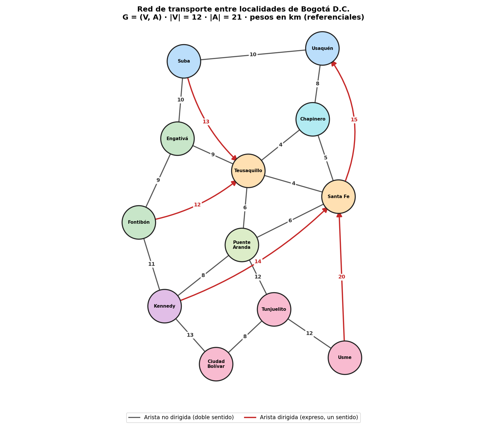
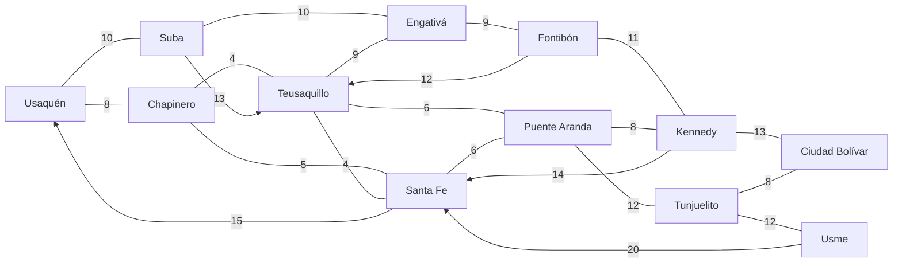

# Guía 12 – Introducción a grafos y redes complejas

**Asignatura:** Estructura de Datos II · Ingeniería de Software / Sistemas · Semestre IV
**Ecosistema:** Java / GitHub

## 1. Dominio y abstracción del problema

**Dominio elegido: transporte urbano en Bogotá D.C.** Se modela una red de rutas entre 12 localidades de la ciudad (troncales, alimentadores y vías arteriales principales).

| Elemento del grafo | Qué representa en el problema |
|---|---|
| Vértice | Una localidad de Bogotá (nodo de la red de transporte) |
| Arista no dirigida | Vía de doble sentido: se recorre en ambos sentidos |
| Arista dirigida | Ruta expresa de un solo sentido (ej. servicio exprés hacia el centro) |
| Peso | Distancia aproximada por vía entre los centros de las localidades, en km (valores referenciales) |

## 2. Tabla de vértices (|V| = 12)

| N° | Localidad | Zona | Grado (aristas incidentes) | Grado salida | Grado entrada |
|---|---|---|---|---|---|
| 1 | Usaquén | Norte | 3 | 2 | 3 |
| 2 | Suba | Norte | 3 | 3 | 2 |
| 3 | Chapinero | Centro-Norte | 3 | 3 | 3 |
| 4 | Engativá | Occidente | 3 | 3 | 3 |
| 5 | Teusaquillo | Centro | 6 | 4 | 6 |
| 6 | Santa Fe | Centro | 6 | 4 | 5 |
| 7 | Fontibón | Occidente | 3 | 3 | 2 |
| 8 | Puente Aranda | Centro-Occidente | 4 | 4 | 4 |
| 9 | Kennedy | Suroccidente | 4 | 4 | 3 |
| 10 | Tunjuelito | Sur | 3 | 3 | 3 |
| 11 | Ciudad Bolívar | Sur | 2 | 2 | 2 |
| 12 | Usme | Sur | 2 | 2 | 1 |

## 3. Tabla de aristas (|A| = 21)

| N° | Origen | Destino | Peso (km) | ¿Dirigida? | ¿Ponderada? |
|---|---|---|---|---|---|
| 1 | Usaquén | Chapinero | 8 | No | Sí |
| 2 | Usaquén | Suba | 10 | No | Sí |
| 3 | Suba | Engativá | 10 | No | Sí |
| 4 | Chapinero | Teusaquillo | 4 | No | Sí |
| 5 | Chapinero | Santa Fe | 5 | No | Sí |
| 6 | Teusaquillo | Santa Fe | 4 | No | Sí |
| 7 | Teusaquillo | Engativá | 9 | No | Sí |
| 8 | Teusaquillo | Puente Aranda | 6 | No | Sí |
| 9 | Santa Fe | Puente Aranda | 6 | No | Sí |
| 10 | Engativá | Fontibón | 9 | No | Sí |
| 11 | Fontibón | Kennedy | 11 | No | Sí |
| 12 | Puente Aranda | Kennedy | 8 | No | Sí |
| 13 | Puente Aranda | Tunjuelito | 12 | No | Sí |
| 14 | Kennedy | Ciudad Bolívar | 13 | No | Sí |
| 15 | Tunjuelito | Ciudad Bolívar | 8 | No | Sí |
| 16 | Tunjuelito | Usme | 12 | No | Sí |
| 17 | Suba | Teusaquillo | 13 | **Sí** | Sí |
| 18 | Fontibón | Teusaquillo | 12 | **Sí** | Sí |
| 19 | Kennedy | Santa Fe | 14 | **Sí** | Sí |
| 20 | Usme | Santa Fe | 20 | **Sí** | Sí |
| 21 | Santa Fe | Usaquén | 15 | **Sí** | Sí |

## 4. Diagrama del grafo



* `diagrama.png`: imagen lista para adjuntar en Moodle.
* `diagrama.drawio`: versión editable. Se abre en [app.diagrams.net](https://app.diagrams.net) con *Archivo → Abrir desde → Dispositivo*; allí se puede reacomodar o exportar de nuevo.
* Código Mermaid equivalente (se puede pegar en Draw.io: *Organizar → Insertar → Avanzado → Mermaid*). Las líneas sin flecha son no dirigidas; las flechas son dirigidas.



## 5. Clasificación formal y justificación

**G = (V, A)** con |V| = 12 y |A| = 21.

| Característica | Resultado | Justificación |
|---|---|---|
| Dirección | **Mixto** | 16 aristas son no dirigidas (vías de doble sentido) y 5 son dirigidas (expresos de un solo sentido). |
| Ponderación | **Ponderado** | Cada arista tiene un peso positivo: la distancia en km. |
| Conectividad | **Conexo** (y fuertemente conexo) | Ignorando el sentido, existe camino entre todo par de localidades. Respetando el sentido, también: las 16 aristas no dirigidas ya conectan las 12 localidades en ambos sentidos, y los 5 arcos dirigidos solo añaden rutas. |
| Ciclos | **Cíclico** | Existe al menos un ciclo (ver ejercicio 2). |
| Densidad | **Disperso** | D = 37 / (12·11) = **0.280**, menor que 0.5 (ver ejercicio 3). |

## 6. Ejercicios

### Ejercicio 1 – Convertir el grafo no dirigido en dirigido

Método `Grafo.convertirADirigido()`. Cada arista no dirigida (u, v) se reemplaza por dos aristas dirigidas u → v y v → u, con el mismo peso. El grafo pasa de 21 a **37 aristas**, todas dirigidas (16·2 + 5 = 37).

**Cambio semántico:** una arista no dirigida expresa una relación simétrica (una sola vía que sirve en ambos sentidos). Al dirigirla, cada sentido pasa a ser una relación independiente: se puede asignar un peso distinto a la ida y a la vuelta (por ejemplo, por congestión en hora pico o por pendiente), cerrar un solo sentido (pico y placa, obras), y los grados se separan en entrada y salida.

### Ejercicio 2 – Ciclo en el grafo

Sí existe. El programa encuentra (DFS) el ciclo:

`Chapinero → Teusaquillo → Santa Fe → Chapinero` (aristas 4, 6 y 5).

También existe un ciclo **dirigido** que respeta los sentidos: `Kennedy → Santa Fe → Puente Aranda → Kennedy` (aristas 19, 9 y 12), y uno más largo: `Santa Fe → Usaquén → Suba → Teusaquillo → Santa Fe` (aristas 21, 2, 17 y 6).

### Ejercicio 3 – ¿Denso o disperso?

Con arcos reales = 16·2 + 5 = 37 y n = 12:

D = 37 / (n·(n−1)) = 37 / 132 ≈ **0.280**

Como D < 0.5, el grafo es **disperso**: solo existe alrededor de un cuarto de las rutas posibles. Es lo esperado en una red de transporte, donde cada localidad se conecta únicamente con las vecinas más cercanas, no con las 11 restantes.

## 7. Estructura del código

| Archivo | Responsabilidad |
|---|---|
| `Vertice.java` | Localidad: nombre y zona de la ciudad. |
| `Arista.java` | Ruta: origen, destino, peso y si es dirigida (código base de la guía, con validaciones). |
| `Grafo.java` | Lista de adyacencia, grados, densidad, conectividad (BFS), ciclos (DFS) y conversión a dirigido. |
| `Main.java` | Construye la red y muestra tablas, clasificación y ejercicios. |

## 8. Compilar y ejecutar

```bash
javac -encoding UTF-8 -d out *.java
java -Dfile.encoding=UTF-8 -Dstdout.encoding=UTF-8 -cp out Main
```

Requiere JDK 17 o superior. Si en Windows las tildes se ven mal en la consola, ejecute antes `chcp 65001`.

## 9. Entrega en GitHub

```bash
git init
git add .
git commit -m "Guía 12: introducción a grafos (localidades de Bogotá)"
git branch -M main
git remote add origin https://github.com/<usuario>/12-introduccion-grafos.git
git push -u origin main
```

Subir a Moodle: diagrama, tablas (este README), clasificación justificada y el enlace al repositorio.

> Las distancias son aproximadas y referenciales; el objetivo de la guía es el modelado, no la precisión cartográfica.
